<p align="center">
  
</p>

<p align="center">
  <a href="https://github.com/zeroznet/nadrbomz/actions/workflows/ci.yml"></a>
  <a href="https://github.com/zeroznet/nadrbomz/commits/main"></a>
  <a href="LICENSE"></a>
  
</p>

```text
 ░▒▓█ S P E C S █▓▒░

 PLATFORMS ..... Linux * FreeBSD * macOS * WSL
 NEEDS ......... git, zsh, curl or fetch
 OPTIONAL ...... claude + jq for the plugin bootstrap
 SHELL ......... POSIX sh, set -eu, no bashisms
 BACKUPS ....... every overwritten target keeps one <target>.bak
 LICENSE ....... BSD-2-Clause
```

Personal shell and Claude Code environment bootstrap. One curl drops zsh, bash, tmux, screen, Neovim, SSH and Claude config onto a fresh box, then plays itself out like a 1990 crack release.

## ▓▒░ I N S T A L L ░▒▓

```sh
curl -fsSL https://raw.githubusercontent.com/zeroznet/nadrbomz/main/nadrbomz.sh | sh
```

FreeBSD base has no `curl`, so use `fetch`; the script falls back to it on its own:

```sh
fetch -q -o - https://raw.githubusercontent.com/zeroznet/nadrbomz/main/nadrbomz.sh | sh
```

To run only what you have reviewed, deploy from a local clone instead of GitHub:

```sh
git clone https://github.com/zeroznet/nadrbomz.git && cd nadrbomz
NADRBOMZ_CLONE_URL="file://${PWD}" sh nadrbomz.sh
```

Missing `git`, `zsh` or a downloader stops the run before anything is touched and prints the install command for your package manager. The outro ends with `exec zsh` and the `chsh` line for your OS.

## ▓▒░ T H E &nbsp; R U N ░▒▓

The script shallow-clones this repo once and deploys every file from that one snapshot, so a run never mixes old and new files. Progress comes in six numbered sections with one `[ OK ]`, `[SKIP]` or `[WARN]` line per item. Git and installer chatter stays quiet and is replayed only when something fails.

### `01/06` S H E L L &nbsp; C O R E

- Oh My Zsh, installed unattended if missing, keeping the existing `~/.zshrc`
- `zsh-autosuggestions`, cloned or fast-forwarded in `$ZSH_CUSTOM/plugins`

### `02/06` D O T F I L E S

| Source | Target | Role |
|---|---|---|
| `zshrc_zero` | `~/.zshrc` | interactive zsh: Oh My Zsh, prompt, history, keychain |
| `zshenv_zero` | `~/.zshenv` | every zsh: `~/.local/bin` on PATH, shared agent socket on WSL |
| `bashrc_zero` | `~/.bashrc` | interactive bash, same prompt and agent logic |
| `shell_aliases_zero` | `~/.shell_aliases` | aliases and functions shared by zsh and bash |
| `init.vim_zero` | `~/.config/nvim/init.vim` | Neovim |
| `tmuxrc_zero` | `~/.tmux.conf` | tmux |
| `screenrc_zero` | `~/.screenrc` | GNU Screen |
| `fastfetch_zero` | `~/.config/fastfetch/config.jsonc` | fastfetch |
| `ssh_config_zero` | `~/.ssh/config` | hosts and keepalive defaults |

### `03/06` W S L &nbsp; T O O L S

Only where the kernel release contains `microsoft`:

| Source | Target | Role |
|---|---|---|
| `ssh-key-ensure_zero` | `~/.local/bin/ssh-key-ensure` | starts one ssh-agent on a fixed socket and loads the key once per boot |
| `wt-connect_zero` | `~/.local/bin/wt-connect` | Windows Terminal remote tab: ensure the agent, then run an ssh alias |

In a local WSL session every Windows Terminal tab shares that agent and the passphrase is asked once. SSH logins and non-WSL hosts keep the forwarded agent or keychain.

### `04/06` C L A U D E &nbsp; C O N F I G

| Source | Target |
|---|---|
| `claude/skills/` | `~/.claude/skills/` |
| `claude/commands/` | `~/.claude/commands/` |
| `claude/scripts/` | `~/.claude/scripts/` |
| `claude/statusline-command.sh` | `~/.claude/statusline-command.sh` |
| `claude/settings.json` | `~/.claude/settings.json` |
| `dev/CLAUDE.md` | `~/dev/CLAUDE.md` |
| `dev/HOWTO.md` | `~/dev/HOWTO.md` |

Directories are merged into place, so a skill deleted here stays on the box until removed by hand.

### `05/06` C L A U D E &nbsp; P L U G I N S

Reads `settings.json`, registers each `extraKnownMarketplaces` entry the CLI does not know yet, then installs each `enabledPlugins` entry that is missing, at its current marketplace version. Plugin code is never vendored. Built-in plugins (`*@builtin`, such as `cc-plugin-you-should-know`) ship with the CLI and are only enabled through `settings.json`. Needs `claude` and `jq`; without either the section is skipped.

### `06/06` T E R M I N A L

FreeBSD's stale `xterm-256color` entry encodes the 8 base colours with an unconditional `setaf`, so bold plus a base colour renders as a heavier font instead of a bright colour. The script compiles a corrected entry into `~/.terminfo`. Where the entry is already right (Linux) it does nothing.

## ▓▒░ T H E &nbsp; S H O W ░▒▓

The banner above is the real intro. On a terminal of at least 75x25 the logo decrypts out of noise into a flowing chrome gradient between copper bars, release info types itself over a parallax starfield and a sine scroller carries the greetz. Any key skips to the final frame. Smaller terminals get that final frame held for 3 seconds. The outro closes with a scoreboard of deployed, skipped and warned items, the runtime and the next moves.

Colours, animation and holds apply only on a TTY. Setting `NO_COLOR`, `TERM=dumb` or piping the output gives plain text.

`assets/cracktro.svg` is rendered from the awk program inside `nadrbomz.sh`, so logo, palettes, credits and scroller text have one source. After changing the intro, regenerate it and commit both:

```sh
python3 assets/render-cracktro.py
```

## ▓▒░ G R E E T Z ░▒▓

ohmyzsh crew * zsh-users * tmux posse * neovim mafia * razor 1911 * fairlight * future crew * the black lotus * every sysop still running screen

## ▓▒░ L I C E N S E ░▒▓

BSD-2-Clause, see [LICENSE](LICENSE). Written by Robert Bopko ([zeroznet](https://github.com/zeroznet)) with Boba Bott (Claude).

<p align="center"><sub><i>zero fear. zero bloat. zeroznet.</i></sub></p>
